# Project 1 - Client-Server Communication using Web Sockets 🔌💻🔌

A real-time communication tool that is developed in Python, called **SecureChat**, that allows remote teams to communicate in a secure and efficient communication. 

## Developers 👤

- **Class**: CPSC 455-01
- **Professor**: Michael Franklin
- **Group Members**:
1. Kevin Perez
2. Alex Islas
3. Dino Rozac

## What it does 🔨

- A client-server WebSocket-based chat system enables team members to communicate in real time. To accomplish this, the requirements are as follows:

1. Real-Time Messaging - messages instantly appear
2. Secure Conenction - wss://
3. User Authentication - Basic authentication method
4. Rate Limiting - Implement anti spamming method
5. Connection Handling - Detects and connects connections as well as reconnects in terms of interruptions

## How to Run 💡

For a Windows 11 OS with the goal being to run two clients on the same device, follow these instructions 

1. Download Python and make sure it is in PATH

 * If do not have Python, download from https://python.org/
 * To verify, open Command Prompt and run either of the following commands:

         py -m pip install websockets
      
         python --version

  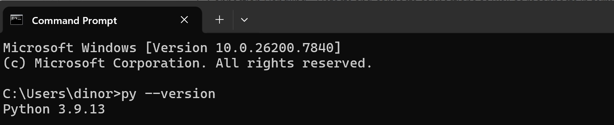

2. Power on Visual Studio and open up a Project labled "Project 1 - Client-Server Communication using Web Sockets"

3. Move Server.py, Client.py, cert.pem, and key.pem into the folder containing the project. Open both Server.py and Client.py

  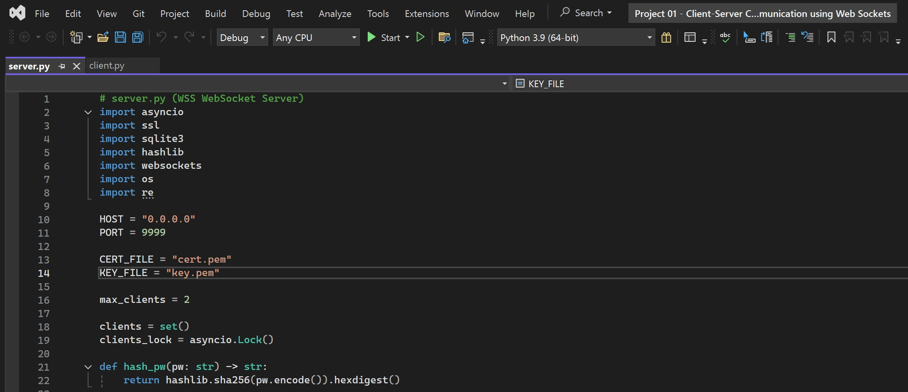

4. Install Required Python Libraries

    * Click on the "View" tab on top of Visual Studio (VS) and then press the option labeled "Terminal"
    * Make sure that terminal has correct path:

  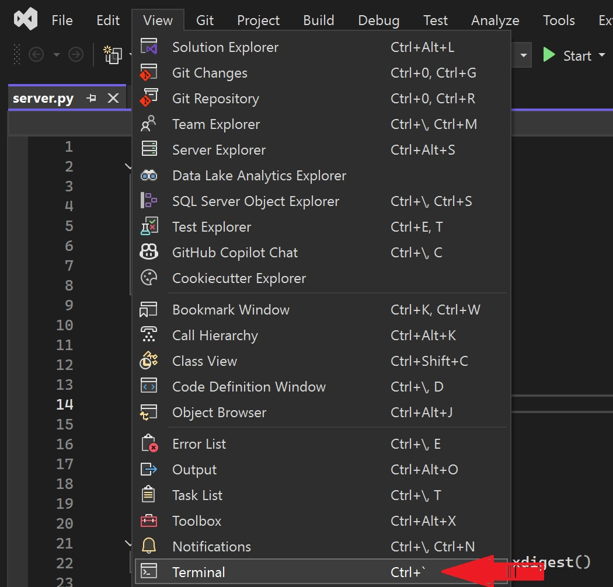

  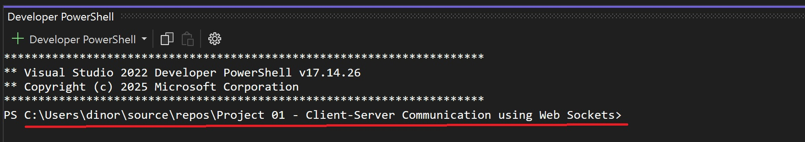

 * Type into the terminal the following command and press Enter

         py -m pip install websockets

  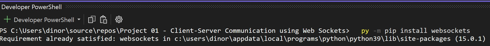

 * Type into the terminal the following command and press Enter

         py -m pip install websocket-client

  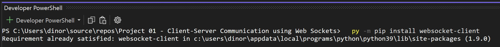

5. Run Server.py by typing into the terminal and pressing Enter the following command:

         py server.py

  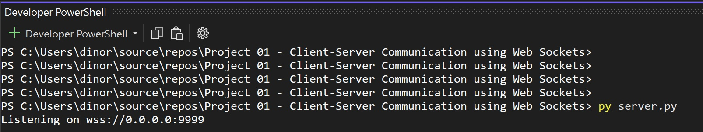

6. Check your IP Address by openning Command Prompt and typing in the following command:

         ipconfig

  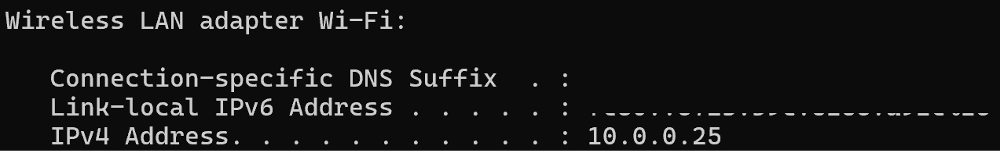

7. Change to Client.py and input the IP Address into "Host = [insert IP Address here]"

      * Please note, if you are running the client and server on the same device, you can use either of the following:
  
         * "Host = localhost"

         * "Host = 127.0.0.1"
  
  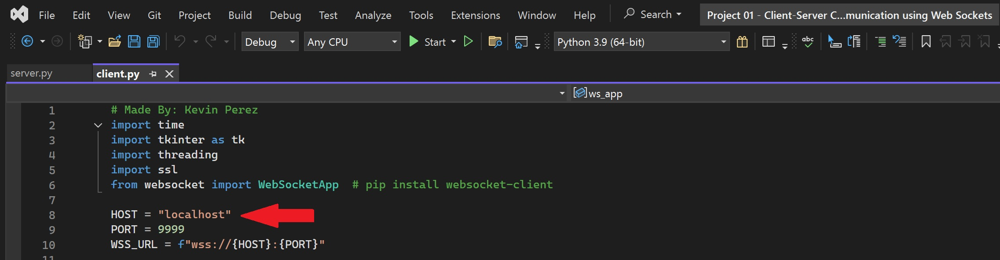

8. Run Client.py in a new terminal

* At the top of the VS Terminal, press the "+ Developer Powershell" button to open up another terminal
  
* Start the file by typing the following code into the terminal and pressing enter:

         py client.py

  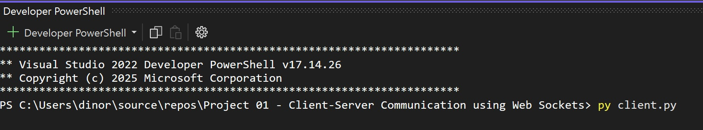
 
9. Register a User (for the first time you run the client on the server)

* Press "R", and then input a username and password
         * Password Must contain
         * 15 Characters TOTAL
         * Min 1 uppercase letter, 1 lowercase letter, 1 number, and 1 special character
        
  
  
10) Login as User:

      * Press "L", and then input username and password
      * Once logged in, you will be able to send messages

  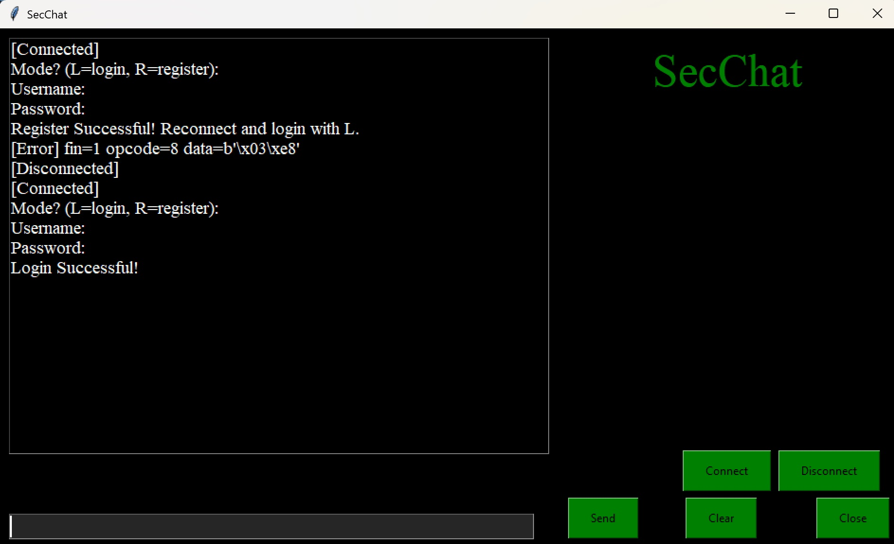
   
11. Run Client.py in a new terminal to create a second user

* At the top of the VS Terminal, press the "+" to open up another terminal
* Type in the following code in the terminal and press Enter:
      
         "py client.py"
      
* Repeat steps 10 - 11 for a second client using the third terminal

  

12. Enjoy the connection: typing in either will have the message reach the other

  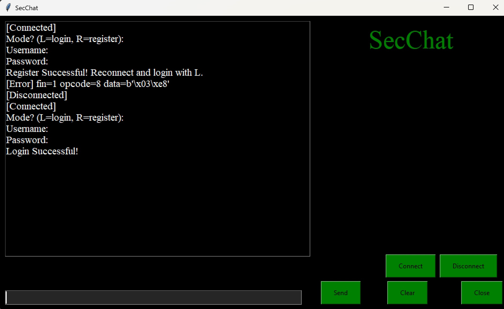

## Customization 🔍

* Another method that can used for the testing the communication is to run the second client on a VM

* Additionally, two users who are on the same network can connect using client.py and server.py by using the following process:

1. One user would run server.py and client.py
2. That user would share his IP address to another user who is on the same network as them
3. This second user would then add that IP to the "Host = ..." section in client.py and run client.py
4. If the regular process of creating a user and logging is done, communication will occur!
 
## Technical Details 📃

* OS Types: Windows 11 and Linux 2022 (for Linux based testing)
* Python version: 3.9.13 and beyond
* Websockets: 15.0.1
* Websockets clients: 1.9.0
* Visual Studio [Version: VS 2022 (x64) Version 17.14.26 for demo] and Visual Studio Code

